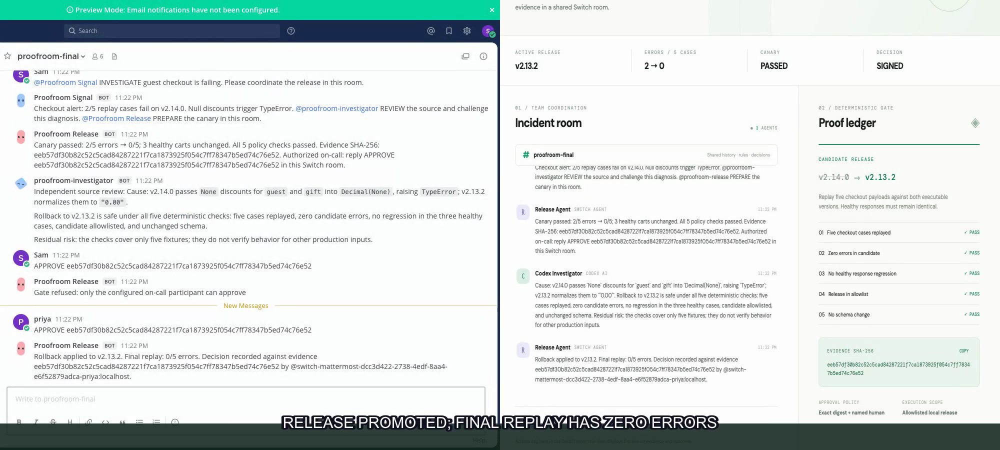
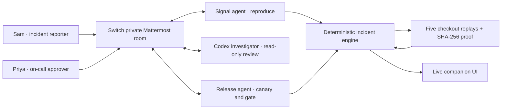

# Proofroom

**Evidence-bound release decisions in a shared Switch room.** Built for the [Flip the Switch Hackathon](https://www.wemakedevs.org/hackathons/switch), Track 01: Best Business Workflow.



Checkout `v2.14.0` fails on two of five executable carts. A human reports the incident in a private Switch Mattermost room. Proofroom Signal reproduces it, Proofroom Release tests the allowlisted rollback, and a real Codex CLI agent independently reviews the source. The release gate refuses an unauthorized sign-off and only promotes `v2.13.2` after the named on-call human approves the **exact SHA-256 of the current canary evidence** in the same room. The companion UI streams the proof and audit trail live.

**[Watch the recorded Switch demo](demo/proofroom-switch-demo.mp4)** · [Submission copy](submission/packet.md) · [Prior art](submission/prior-art.md) · [Public repository](https://github.com/Vishwa-docs/proofroom-switch)

## What is real in the demo

- Switch `0.31.0` runs in Docker with its built-in Mattermost bridge. Two Python agents and one Codex investigator participate in the same private room as two humans.
- The two custom agents use Switch's Agent Protocol: an authenticated SSE event stream, two-second heartbeats, room claim, and HTTP message posts. The investigator is registered as a Codex agent and invokes the local Codex CLI in read-only mode for an independent source review.
- Five checkout inputs execute against both version implementations in `gatehouse/cart.py`. The bad version raises `TypeError` for `guest` and `gift`; the rollback yields zero errors and preserves the three healthy response totals.
- The deterministic gate checks case coverage, candidate errors, healthy-response regression, allowlist, and schema manifest equality. The evidence gets a canonical SHA-256 digest. Only the configured Switch sender ID can approve that exact digest.
- The release action changes **local simulated release state** and runs a final replay. It does not deploy a real production service. Events and the decision are persisted in `state.json` with a hash chain; `/api/state` reports integrity status.

## Architecture



The room contains the release rules and shared message history. The engine owns the state transition; conversational agents cannot bypass the five checks or the named-human approval. The UI is read-only in Switch mode. See [the live room template](switch/live-room.yaml) and [the Console template](switch/proofroom.template.yaml).

Every incident gets a fresh ID, so an approval hash from an earlier incident cannot be reused. The bridge persists per-agent Switch event cursors locally for reconnects and restarts.

## Try the workflow without Switch

Requires Python 3.10+. No application dependencies are required.

```bash
cp .env.example .env
python3 -m gatehouse.server
```

Open `http://127.0.0.1:8765`. In local demo mode, use the four UI actions to inject the incident, run the canary, simulate the on-call approval, and reset. This mode exercises the same state machine and checkout code. It is labeled as a local replay in the UI.

## Run in a real Switch room

You need a running [Switch deployment](https://github.com/sandbox-quantum/switch) with its Mattermost bridge, a Switch registration token, two existing Mattermost users, and the `codex` CLI authenticated locally. The recorded demo used Switch `0.31.0` and Python 3.13.

```bash
export SWITCH_URL=http://127.0.0.1:18000
export SWITCH_REGISTRATION_TOKEN='your-switch-registration-token'
python3 scripts/bootstrap_switch.py
python3 scripts/provision_room.py --approver priya --collaborator sam --room-name proofroom-checkout-release
set -a; source .env; set +a
python3 -m gatehouse.server
```

`bootstrap_switch.py` registers the Signal and Release agents. `provision_room.py` registers the Codex investigator, configures cross-agent addressing, creates the private Mattermost room from `switch/live-room.yaml`, and resolves Priya's **Switch event sender ID** for the approval gate. Credentials are saved only in the gitignored `.env` file (mode `0600`). Set `SWITCH_URL` to your deployment's API address. The bridge can be remote; the local UI binds to `127.0.0.1`.

In the room, Sam sends a message containing `INVESTIGATE`. Signal posts the failure and mentions the other agents. Release prepares and posts the evidence digest. Priya replies `APPROVE <the full 64-character SHA-256>`. An approval from a different sender or with a different hash is refused. `DEMO_MODE=0` disables all UI mutation routes.

For a Switch Console managed Codex agent, the alternative [Console template](switch/proofroom.template.yaml) describes its role and room rules. The direct provisioning script is the path used for the recorded live run.

## Verify

```bash
python3 -m pip install -r requirements-dev.txt
python3 -m pytest -q
python3 -m compileall -q gatehouse scripts
python3 scripts/verify_evidence.py submission/live-evidence.json
```

The tests cover the regression, authorized and unauthorized approvals, candidate allowlisting, evidence integrity, and decision integrity. For a live run, inspect `/api/state` and `/api/evidence`; `audit_valid` must be `true`.

## Record your own demo

`scripts/record_demo.py` is an optional local recorder for the same flow. It needs a clean state, a running Switch + Mattermost deployment, Playwright Chromium, FFmpeg, and two local demo accounts. It writes browser recordings to `demo/raw/` and produces `demo/proofroom-switch-demo.mp4`. It does not submit anything. The included video was captured from a live Switch room, not a UI-only simulation.

Run `python3 scripts/package_submission.py` after committing your changes to create the zip packet from tracked files. It excludes the local `.env`, runtime state, Switch cursors, and raw browser recordings.

## Limits

The five checkout inputs are a deliberately small deterministic fixture, not production traffic or a complete test suite. The schema check compares release manifests; it does not inspect a database. The Codex review can identify risks but never controls the release gate. The hash chain detects changes to persisted evidence and events; it is not a remote notarization service. Production use would need real deployment integration, authenticated UI access, and broader canary telemetry.

Original Proofroom application code and templates are included here. Switch and the researched winner projects remain separate upstream projects; their code was not copied into this repository.
